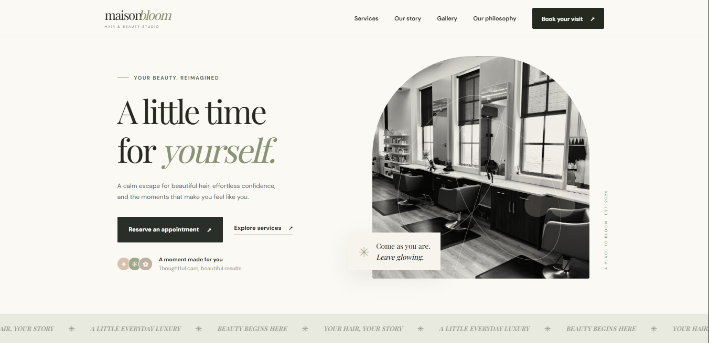
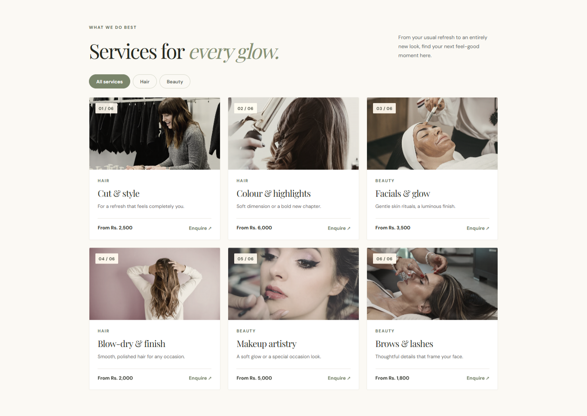
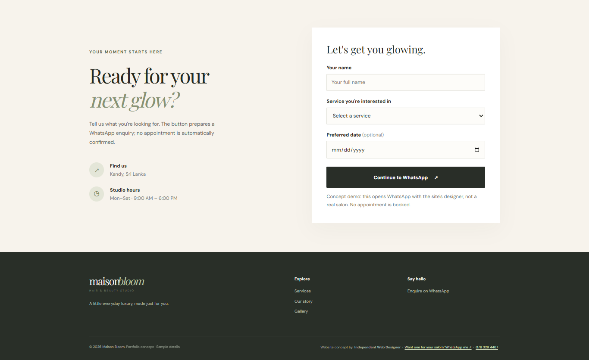
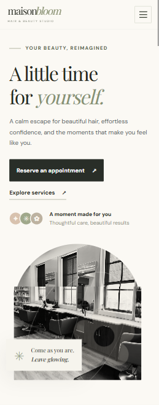

# Maison Bloom | Salon Website Concept

### A Modern, Elegant & Responsive Beauty Salon Website

**Maison Bloom** is a premium salon website concept designed to demonstrate how a modern digital presence can help beauty and wellness businesses showcase their services, strengthen their brand identity, and make customer enquiries easier.

This project is part of my independent web development portfolio, showcasing my approach to building visually appealing, responsive, and user-friendly websites for small businesses.

**[🌐 Live Website Demo](https://YOUR-LIVE-URL.pages.dev)**

---

## Project Preview

*An elegant, responsive website designed with a focus on visual storytelling, usability, and customer engagement.*

### Mobile Experience

## The Problem

Many small businesses rely primarily on social media platforms to communicate with customers.

While Instagram and Facebook are useful for marketing, important business information such as service lists, pricing, opening hours, and contact details can become difficult to find.

A dedicated website provides a centralized, professional experience where potential customers can quickly discover what a business offers.

## The Solution

Maison Bloom demonstrates a lightweight, mobile-first website solution tailored to the needs of a modern beauty salon.

The concept focuses on three priorities:

- **Professional presentation:** Establishing an elegant and consistent digital brand.
- **Service discovery:** Helping customers explore treatments, services, and pricing.
- **Easy communication:** Simplifying enquiries through WhatsApp integration.

The website does not require a complex backend or customer account system.

## Key Features

**Elegant & Responsive Design**
- Modern editorial-style layout
- Mobile-friendly navigation
- Consistent visual design and typography
- Responsive layouts for desktop, tablet, and mobile

**Interactive Service Catalogue**
- Six visually presented salon services
- Hair and beauty category filtering
- Clear service descriptions
- Direct service enquiry actions

**WhatsApp Enquiry Integration**
- Convenient enquiry flow
- Service-specific enquiry selection
- No account registration required
- Designed to simplify customer communication

**Additional Features**
- Image gallery
- Salon introduction
- Smooth navigation
- Contact and enquiry form
- Social media links
- Search-engine metadata
- Social sharing preview metadata

## Technology Stack

| Technology | Purpose |
|---|---|
| HTML5 | Website structure and semantic content |
| CSS3 | Styling, animations, and responsive layouts |
| JavaScript | Interactive features and enquiry functionality |
| Git & GitHub | Version control |
| Cloudflare Pages | Static website hosting and deployment |

**Architecture:** Lightweight static website without backend dependencies.

## Design Approach

Maison Bloom follows a minimalist, editorial-inspired design philosophy.

The visual experience emphasizes warm neutral colours, elegant typography, professional imagery, clean spacing, and intuitive navigation.

The layout is designed to present salon services clearly while encouraging visitors to enquire.

## Project Highlights

- Developed using HTML, CSS, and vanilla JavaScript.
- Designed for responsive viewing across multiple screen sizes.
- Demonstrates how small businesses can establish an online presence without expensive infrastructure.
- Includes interactive functionality without requiring a backend.
- Structured to allow future business-specific customization.

## Potential Future Enhancements

The concept can be extended with additional functionality based on individual business requirements:

- Online appointment scheduling
- Google Maps integration
- Staff profiles and service specialists
- Customer testimonials and reviews
- Multilingual support
- Content management dashboard
- Online payments

## Interested in a Website for Your Business?

I build modern, responsive websites for small businesses, with a focus on usability, visual design, and practical business needs.

Whether you need a salon website, business landing page, portfolio, or customized web solution, I'm open to discussing your project.

**Contact:** [Connect with me on LinkedIn](https://www.linkedin.com/in/duleepa01/)

**Portfolio:** Coming soon

---

### Project Disclaimer

Maison Bloom is an independent portfolio concept created for demonstration purposes. It does not represent a real salon or a commissioned client project. Business information, service pricing, and example imagery are illustrative.

**© 2026 Maison Bloom Website Concept. Designed & Developed as an Independent Portfolio Project.**
